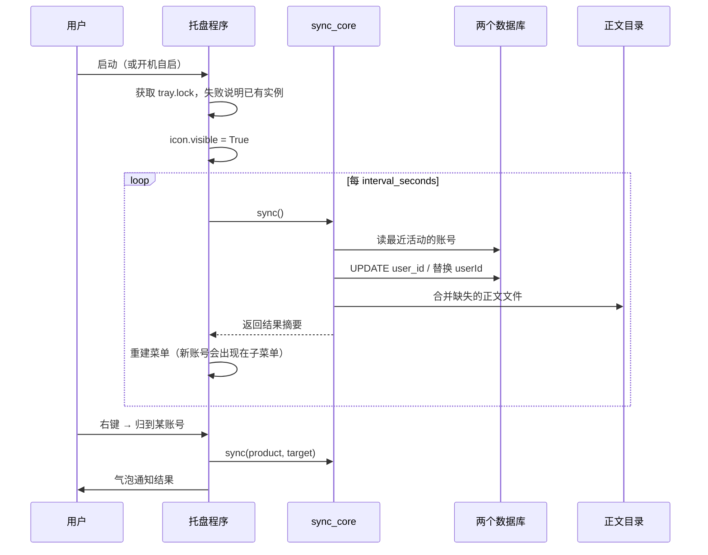

# 架构说明

本文解释这个工具具体改了哪些文件、为什么必须改三处、以及哪些地方容易踩坑。

---

## 一、整体拓扑

```
                            ┌──────────────────────────┐
                            │   src/sync_core.py       │
                            │   每 N 秒跑一次           │
                            └────────────┬─────────────┘
                                         │
              ┌──────────────────────────┼──────────────────────────┐
              │                          │                          │
              ▼                          ▼                          ▼
   ┌────────────────────┐    ┌────────────────────┐    ┌────────────────────┐
   │  ① WorkBuddy 索引   │    │ ② CodeBuddy 索引   │    │ ③ CodeBuddy 正文   │
   │  workbuddy.db      │    │ codebuddy-         │    │ Data/<uid>/...     │
   │  sessions 表        │    │ sessions.vscdb     │    │ history/           │
   │                    │    │ ItemTable          │    │                    │
   │ UPDATE user_id     │    │ 替换 userId 字符串  │    │ 合并目录，只补缺失  │
   └────────────────────┘    └────────────────────┘    └────────────────────┘
```

三处必须都处理，少任何一处都会出现"列表有但点开是空的"或者"列表都没有"。

---

## 二、三个数据面详解

### ① WorkBuddy 索引

**位置**：`%USERPROFILE%\.workbuddy\workbuddy.db`（SQLite，WAL 模式）

**关键表**：

```sql
CREATE TABLE sessions (
    ...,
    user_id    TEXT,      -- 归属账号
    updated_at INTEGER,   -- 最后活动时间，用来判断"当前账号"
    deleted_at INTEGER,   -- 软删除标记
    ...
);
```

**操作**：

```sql
UPDATE sessions SET user_id = :target WHERE user_id <> :target;
```

一句 SQL 搞定。

**判断当前账号**：取 `updated_at` 最大的那条会话的 `user_id`。人正在用的号，一定刚产生过活动。

**为什么正文不用管**：WorkBuddy 的会话正文在 `%USERPROFILE%\.workbuddy\projects\<项目名>\*.jsonl`，路径里不含账号 ID，天然共享。这也解释了为什么它"看起来"丢失得更彻底——索引一过滤，正文就全成了孤儿。

### ② CodeBuddy 索引

**位置**：`%APPDATA%\CodeBuddy CN\codebuddy-sessions.vscdb`（SQLite）

**结构**：单表 `ItemTable`，一行一个会话：

```
key   = "session:<会话ID>"
value = {"conversationId": "...", "cwd": "d:/xxx",
         "userId": "<账号ID>", "title": "...",
         "createdAt": 1789477443668, "updatedAt": 1789981029187, ...}
```

**操作**：把 JSON 字符串里的 `userId` 值替换掉。

```python
new = raw.replace(old_uid, target_uid)
```

用字符串替换而不是 `json.loads` / `json.dumps` 回写，是为了保住原始字段顺序和未知字段——这类数据库经常被软件自己重写，格式上尽量少动。

**判断当前账号**：取 `updatedAt` 最大的那条。

### ③ CodeBuddy 正文

**位置**：

```
%LOCALAPPDATA%\CodeBuddyExtension\Data\<账号ID>\CodeBuddyIDE\<账号ID>\history\
    <工作区哈希>\
        index.json      该工作区有哪些会话
        recent.json     {会话ID: 时间戳}，用于排序
        current.json    当前打开的是哪个会话
        <会话ID>\
            messages\*.json
```

注意账号 ID 出现了**两次**（`Data/<uid>/CodeBuddyIDE/<uid>/`），两层都要对上。

**为什么必须合并目录**：索引里的账号已经改成当前号了，但正文还在另一个号的文件夹里。软件按 `Data/<当前uid>/...` 去找文件，找不到就是空会话。

**合并策略**：

| 对象 | 做法 |
|---|---|
| 会话正文文件 | `copytree` + 自定义 copy_function，目标存在就跳过 |
| `index.json` | 按会话 ID 去重合并，保留双方的条目 |
| `recent.json` | 键取并集，同一个键取较新的时间戳 |
| `current.json` | 保留目标已有的，不覆盖 |

只补缺失、不覆盖已有，所以可以每隔几分钟跑一次，代价只是遍历一遍文件是否存在。

**性能**：17,000 多个文件，纯 `os.path.exists` 检查大约几秒。之所以能这么快，是因为不比较内容、不做哈希。

---

## 三、账号发现

不从配置里读账号，而是每次现场扫描：

1. 两个数据库里出现过的 `user_id` / `userId`
2. `%USERPROFILE%\.workbuddy\` 下的 UUID 目录名
3. `%LOCALAPPDATA%\CodeBuddyExtension\Data\` 下的 UUID 目录名

第 2、3 步是必要的补充：记录被归并之后，数据库里往往只剩当前账号一个值，但**目录还在**，靠目录才能记住这台机器上曾经登过几个号，从而让手动切换菜单不会退化成只有一个选项。

过滤规则是标准 UUID 格式（8-4-4-4-12 的十六进制），自动排除 `Public`、`default`、`*.bak` 这些非账号目录。

数量和顺序都不写死，扫到几个就是几个。

### 账号昵称从哪来

数据库里只存 UUID，没有名字。唯一能拿到明文昵称的地方是 **CodeBuddy 的扩展日志**：

登录时扩展会调用 `getUserInfo`，把返回结果写进日志，长这样：

```json
[{"uid":"12345678-abcd-...","nickname":"某某","uin":"...","lastLogin":true,...}]
```

程序用正则从日志里把 `uid` 和 `nickname` 一起抠出来，第一次扫描会把结果落到 `%APPDATA%\workbuddy-codebuddy-chat-sync\account-names.json` 缓存起来。

几个细节：

- 日志总共上百 MB，但只会打开路径里带 `coding-copilot` / `tencent-cloud` 的日志文件，实测全量扫一遍不到 1 秒
- 缓存只增不删——即使以后日志被轮转清掉，已经认出来的昵称也不会丢
- 昵称的优先级最低，`config.json` 里手填的名字可以覆盖它；再往下的兜底是 ID 前 8 位

---

## 四、运行流程



---

## 五、已知边界

**1. CodeBuddy 的 Agent 窗口按工作区过滤，不按账号**

主窗口读 `codebuddy-sessions.vscdb`，按账号过滤；但"打开 Agents"那个独立窗口读的是 `history/<工作区哈希>/index.json`，按**当前打开的项目目录**过滤。

所以同一个账号，从 `d:/项目A` 打开 Agent 窗口看到的是项目 A 的会话，从 `d:/项目B` 打开看到的是项目 B 的。这跟账号无关，也不是同步能做到的事——想要哪个项目的会话，就从那个项目目录启动。

**2. 软件运行时会缓存列表**

数据库改完之后，已经打开的软件不会立刻刷新，需要重启该软件。这是软件自身的行为，工具无法绕过。

**3. 数据库被占用时写入会失败**

两个软件运行时持有 SQLite 连接。读取用只读模式打开没问题，写入偶尔会碰到 `database is locked`。逻辑里做了 8 秒超时，失败就跳过这一轮，下一轮再试，不会强行写入。

**4. 官方改数据结构会失效**

`ItemTable` 的 JSON 结构、`sessions` 表的字段名都是逆向出来的。官方更新后如果改了，工具会读不到数据然后跳过——不会写坏，但也就不起作用了。

**5. 只做 Windows**

路径全部基于 `%USERPROFILE%` / `%APPDATA%` / `%LOCALAPPDATA%`。

---

## 六、命令行用法

不想用托盘、或者想写进自己的脚本，可以直接跑核心模块：

```bat
cd src

python sync_core.py                     :: 两边各按最近活动同步一次
python sync_core.py --stats             :: 同步并打印账号分布
python sync_core.py --product cb        :: 只处理 CodeBuddy（wb / cb）
python sync_core.py --account <账号ID>   :: 全部归到指定账号
```

`sync_core.py` 不依赖 pystray/Pillow，只有标准库，可以单独拷出去用。

### 环境变量

数据放在非标准位置时用得上（排查问题、或者把数据搬到别的盘）：

```bat
set WB_CB_SYNC_WB_DB=D:\path\to\workbuddy.db
set WB_CB_SYNC_CB_DB=D:\path\to\codebuddy-sessions.vscdb
set WB_CB_SYNC_CB_DATA=D:\path\to\CodeBuddyExtension\Data
set WB_CB_SYNC_DATA=D:\path\to\config-and-log-dir
```

---

## 七、配置项

配置文件：`%APPDATA%\workbuddy-codebuddy-chat-sync\config.json`

| 字段 | 默认值 | 说明 |
|---|---|---|
| `accounts` | `{}` | 账号 ID → 显示名。不填就显示 ID 前 8 位 |
| `auto_sync` | `true` | 启动时是否开启自动同步 |
| `interval_seconds` | `120` | 自动同步间隔，最小 30 秒 |
| `merge_history_files` | `true` | 是否合并 CodeBuddy 的正文目录。关掉后索引能对上，但正文可能是空的 |

改完需要重启托盘程序。
